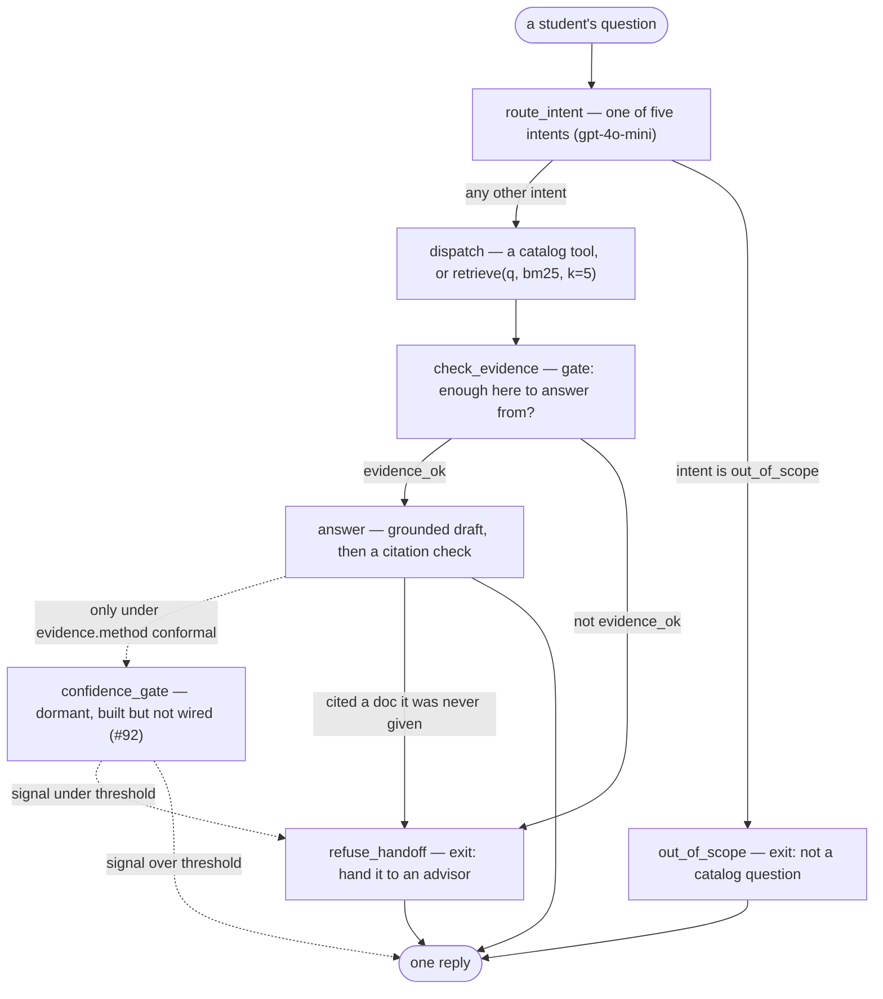
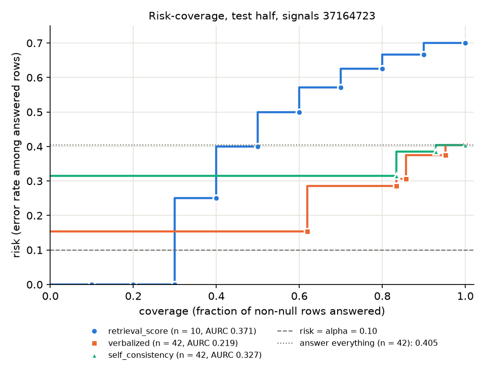

# Knowing when not to answer: a course-planning agent over one university catalog

A retrieval agent that answers questions about a course catalog, and declines the ones the catalog
cannot answer. This is the report for the whole study: what was built, what was measured, on which
rows, and where it fails.

**Every number below traces to a committed file.** Tables sit in generated blocks that
`eval/scripts/final_report.py` rewrites from the run files; a number in the prose carries a `[src]`
link to the file it came from, with the key path in the link's title. `final_report.py --check`
fails the build when a block is stale, a prose number has no link, or a linked value has moved, and
`tests/test_final_report.py` runs it.

Final system: config hash `c73b197d`, retrieval `bm25`, evidence gate `top_score`, chat model
`gpt-4o-mini`. Every headline number is on the frozen `test` half, n = 63 questions
[src](../eval/runs/e2e_metrics_c73b197d.json "n").

<!-- BEGIN gen:overview -->
| | |
| --- | --- |
| dataset | [`eval/datasets/v1.jsonl`](../eval/datasets/v1.jsonl), 127 rows, sha256 `2a93182221bd` |
| split | 64 calib / 63 test, seed `61` |
| config | `c73b197d` (dense index `094143d8`, bm25 index `877a6610`) |
| day 3 | [the eval set](day3_evalset_c73b197d.md) · [second annotator](day3_agreement_c73b197d.md) |
| day 4 | [retrieval ablation](day4_ablation_c73b197d.md) |
| day 5 | [confidence signals and conformal gating](day5_signals_83496e82.md) |
| day 6 | this file, from [`eval/runs/e2e_metrics_c73b197d.json`](../eval/runs/e2e_metrics_c73b197d.json) and [`eval/runs/attribution_test_c73b197d.jsonl`](../eval/runs/attribution_test_c73b197d.jsonl) |
<!-- END gen:overview -->

## 1. Motivation

An assistant that answers questions from a document collection has to decide, on every question,
whether the documents it found actually answer it — and a confident answer to a question the
catalog cannot answer is worse than no answer, because a student acts on it. The usual way to make
that decision is a heuristic threshold: score the retrieved evidence, answer above some number and
decline below it, with the number picked by hand. Day 2 of this project did exactly that — raw BM25
top-1 against a fixed 15.0 [src](../eval/runs/e2e_test_c73b197d.meta.json "evidence.thresholds"),
a cutoff read off twelve example queries — and this study asks what that
choice costs and what a calibrated alternative would buy.

## 2. Research questions

- **RQ1 — retrieval.** Does hybrid retrieval (dense + BM25, fused by RRF) beat the stronger of the
  two single modes on this corpus? *(Day 4)*
- **RQ2 — ranking.** Which confidence signal — retrieval score, the model's verbalized confidence,
  or self-consistency across samples — ranks correct answers above wrong ones? *(Day 5)*
- **RQ3 — gating.** Does a conformal threshold, fitted on a held-out calibration half, hold its
  target error rate where a fixed 0.7 [src](../eval/runs/conformal_eval_83496e82.json "fixed")
  does not? *(Day 5)*

Day 6 asks a fourth question that is not an RQ: with those pieces wired together, how often is the
whole agent right, and when it is wrong, which part was wrong?

## 3. System and method

One query goes in, one of three exits comes out: an answer, a hand-off to a human advisor, or
"that is not what this catalog is for". Six nodes, no cycle.

<!-- BEGIN gen:architecture -->

<!-- END gen:architecture -->

The node names are the keys of `NODE_BUILDERS` in [`agent/graph.py`](../agent/graph.py), and
[`tests/test_final_report.py`](../tests/test_final_report.py) fails if the diagram and the registry
drift apart. The dashed node is the one `agent.graph.CONDITIONAL` marks conditional.

**Routing.** `route_intent` classifies into `course_fact`, `prereq_chain`, `degree_requirement`,
`compare_recommend` or `out_of_scope`. Only `out_of_scope` is a branch in the graph; the other four
differ in *where evidence comes from*, which is dispatch's table.

**Dispatch.** A lookup-shaped question goes to an exact catalog tool (course record, prerequisite
chain, degree requirements); everything else goes to `retrieve()`. A tool result carries no
retrieval score, which matters later: 32 of the 37 answered test rows are tool rows
[src](../eval/runs/e2e_test_c73b197d.meta.json "tool_rows, exits"), and a score-based gate has
nothing to compare on any of them.

**The gate.** `top_score` compares the best-scoring block against a per-source threshold — BM25
15.0, dense 0.46 [src](../eval/runs/e2e_test_c73b197d.meta.json "evidence.thresholds") — because
the three retrieval modes score on three unrelated scales. A hybrid
block is refused outright rather than compared: fused RRF scores are nearly constant at the top of
the list, so no cutoff separates them. A tool result is never compared: an exact lookup has no
ranking to be unsure about.

**The answer node** drafts from the evidence and then checks its own citations; a draft citing a
`doc_id` it was never given is discarded and leaves through the hand-off exit instead. That happened
0 times on the test run [src](../eval/runs/e2e_test_c73b197d.jsonl "citations_unknown").

**The conformal gate is built and dormant.** `evidence.method: conformal` (#92) would add
`confidence_gate` after `answer` and move the config hash to `2d44be6a`. It is not switched on
because the fit accepted no threshold — see RQ3.

## 4. Experimental setup

**Corpus.** One university's course catalog, one term (`2026-sp`): 4,502 courses, 2,086
prerequisite and 34 corequisite edges, 13 Gen Ed categories [src](../README.md "Data"). One course
is one chunk (p50 111 tokens, max 523 [src](../README.md "Chunking")), rendered by a versioned
template so the chunk text is a function of the config. Two indexes are built from those chunks:
Chroma with `text-embedding-3-small` (dense key `094143d8`) and Okapi BM25 with a code boost (bm25 key
`877a6610`).

**The eval set** ([Day 3](day3_evalset_c73b197d.md)) is 127 questions in four buckets, drafted from
the catalog, then verified row by row: 167 rows drafted, 167 judged, 40 deleted
[src](day3_evalset_c73b197d.md "Verification"). Each row carries a gold answer, gold doc ids where
they apply, and whether the right behaviour is to abstain.

<!-- BEGIN gen:dataset_buckets -->
| bucket | rows | calib | test | what it tests |
| --- | --- | --- | --- | --- |
| `fact` | 58 | 29 | 29 | one catalog record answers it |
| `multihop` | 24 | 12 | 12 | two or more records must be joined |
| `unanswerable` | 25 | 13 | 12 | this catalog cannot answer it, so there is nothing to cite |
| `ambiguous` | 20 | 10 | 10 | under-specified; gold_answer holds the clarifying question |
| **total** | **127** | **64** | **63** |  |
<!-- END gen:dataset_buckets -->

**A second annotator** read 15 of the 127 rows [src](../eval/datasets/v1.jsonl "id") against the
written guidelines and nothing else:
bucket agreement 15/15, `answer_correct` 13/15, `citations_support` 15/15
[src](day3_agreement_c73b197d.md "Agreement"). That sheet was reported verbally and transcribed
rather than typed by the second annotator, which the Day 3 report states above its own numbers.

**The split** is half and half within each bucket, frozen into the dataset as a `split` field,
derived from
seed `61` over each bucket's sorted ids. Every threshold and every choice of signal was made on
`calib`; every number in section 5 is on `test`.

**Seeds and keys.** Three constants, each an issue number rather than a tuned value:

<!-- BEGIN gen:seeds -->
| what | seed | key | where |
| --- | --- | --- | --- |
| the frozen split | `61` | config `c73b197d` | `eval.split_seed` |
| the paired bootstrap | `76` | bootstrap key `baa560e9` | `eval.bootstrap` |
| the second-annotator sample | `42` | config `c73b197d` | top-level `seed` |
<!-- END gen:seeds -->

`eval.bootstrap`, `signals`, `correctness` and `conformal` are excluded from the config hash
(`config.AFTER_THE_RUNS`): they are read after every run file exists and cannot change a line of
one, so adding them renamed no index and no earlier report. They do name their own results —
signals key `37164723`, correctness key `c54b1377`, conformal key `83496e82`.

**Model and cost.** `gpt-4o-mini` everywhere, temperature 0 for routing and answering. Day 5's
signal collection cost 9 chat calls per answered row across both halves (880 calls in all)
[src](day5_signals_83496e82.md "1. Setup"); the runs did not record token counts, so there is no
dollar figure here. Latency was never measured
under load.

## 5. Results

Three days of measurement on the same frozen half. Day 4 measures retrieval alone, Day 5 measures
confidence on a run with the gate bypassed, Day 6 measures the whole agent with the gate on. The
denominators differ for that reason and are stated everywhere.

### 5.1 RQ1 — does hybrid beat the strongest single mode?

Recall@5 and MRR@5 through `retrieve(q, mode, k=5)` on the 41 test rows that carry gold doc ids
(`fact` 29, `multihop` 12) [src](../eval/runs/bootstrap_baa560e9.json "n.test, buckets"). The
strongest single mode was chosen on `calib` — `bm25` on both metrics — and then tested on `test`;
choosing it on the test rows would compare hybrid against the larger of two noisy means. Intervals
are 95% paired bootstrap, B = 10,000, seed 76
[src](../eval/runs/bootstrap_baa560e9.json "n_resamples, seed"): one draw of question indices
shared by every mode.

<!-- BEGIN gen:day4_ablation -->
| mode | Recall@5 | MRR@5 |
| --- | --- | --- |
| `dense` | 0.705 [0.571, 0.833] | 0.637 [0.502, 0.764] |
| `bm25` | 0.870 [0.778, 0.951] | 0.923 [0.850, 0.984] |
| `hybrid` | 0.866 [0.783, 0.935] | 0.802 [0.707, 0.891] |
| `hybrid_rerank` | 0.846 [0.748, 0.931] | 0.868 [0.774, 0.945] |
| *hybrid − bm25* | *−0.004 [−0.085, 0.073]*, not significant | *−0.120 [−0.225, −0.023]*, significant |
| *hybrid_rerank − hybrid* | *−0.020 [−0.104, 0.061]*, not significant | *+0.065 [−0.059, 0.186]*, not significant |
<!-- END gen:day4_ablation -->

**No.** On Recall@5 the gap is −0.004 [−0.085, 0.073]
[src](../eval/runs/bootstrap_baa560e9.json "metrics.recall_at_5.difference"): the interval contains
0, so these 41 questions do not separate hybrid from BM25. On MRR@5 the gap is −0.120 [−0.225,
−0.023] [src](../eval/runs/bootstrap_baa560e9.json "metrics.mrr_at_5.difference") and the interval
excludes 0 — BM25 puts the right record first more often than the fusion does. Reranking hybrid's
top 20 with a cross-encoder recovers most of the MRR gap but separates from neither, at a median
cost of 724 ms per question [src](day4_ablation_c73b197d.md "Reranking hybrid's top 20").

Why BM25 wins here is not a mystery: a question that names `CS 374` is a lexical match against a
corpus where every chunk begins with its own course code, and the code boost in the tokenizer makes
that match decisive. The agent therefore runs `bm25`, and RQ1's answer is the reason.

<!-- BEGIN gen:day4_buckets -->
| mode | fact Recall@5 (n = 29) | fact MRR@5 | multihop Recall@5 (n = 12) | multihop MRR@5 |
| --- | --- | --- | --- | --- |
| `dense` | 0.793 | 0.682 | 0.493 | 0.528 |
| `bm25` | 0.966 | 0.908 | 0.639 | 0.958 |
| `hybrid` | 0.966 | 0.829 | 0.625 | 0.739 |
| `hybrid_rerank` | 0.966 | 0.922 | 0.556 | 0.736 |
<!-- END gen:day4_buckets -->

Point estimates only, and deliberately no intervals: at n = 12 one multihop question moves a mean by
1/12. The split says where the rows in the main table come from — retrieval on `fact` is close to
solved, and every mode leaves gold ids out on `multihop`, which is the bucket Day 6's failures live
in. Hybrid misses at least one gold id on 11 of 41 rows: 1 `fact`, 10 `multihop`
[src](day4_ablation_c73b197d.md "Where hybrid misses").

### 5.2 RQ2 — which signal ranks correct answers above wrong ones?

Three signals per answered row, collected on a run with the evidence gate **bypassed** so that every
row with evidence produced an answer to score: `retrieval_score` (BM25 top-1), `verbalized` (the
model's own confidence rating of the written answer) and `self_consistency` (3 samples at
temperature 0.7, all 3 pairs judged) [src](day5_signals_83496e82.md "1. Setup"). A person labelled
every answer correct or incorrect, with an LLM judge's call shown first. Test half: 42 answered
rows, 25 correct [src](day5_signals_83496e82.md "2. Labels").



<!-- BEGIN gen:day5_auroc -->
| signal | n | null | AUROC [95% CI] | AURC |
| --- | --- | --- | --- | --- |
| `retrieval_score` | 10 | 32 | 1.000 [1.000, 1.000] | 0.371 |
| `verbalized` | 42 | 0 | 0.847 [0.722, 0.953] | 0.219 |
| `self_consistency` | 42 | 0 | 0.652 [0.536, 0.778] | 0.327 |
<!-- END gen:day5_auroc -->

**`verbalized`**, the signal chosen on calib, ranks correct above incorrect answers with AUROC
0.847 [0.722, 0.953], against 0.652 [0.536, 0.778] for self-consistency; the difference excludes 0
[src](../eval/runs/risk_coverage_test_37164723.json
"signals.verbalized.auroc, signals.self_consistency.auroc, differences"). `retrieval_score` scores
1.000 with an interval of zero width, and that number should be read as a warning rather than a
result: it is ranked on the 10 of 42 rows that are not tool rows (3 correct, 7 incorrect), the rows
are perfectly separated by chance available to a sample of 10, and 454 of 10,000 resamples drew one
class or none and were skipped [src](day5_signals_83496e82.md "3. RQ2"). Comparing it against the
other two compares different row sets under the same resampled questions, so "excludes 0" there
does not say one signal orders the same answers better than another.

The calib ordering — `verbalized` 0.792, `retrieval_score` 0.760, `self_consistency` 0.575 — is not
the test ordering, which is the ordinary consequence of choosing on 46 rows
[src](../eval/runs/conformal_83496e82.json "signals, n").

### 5.3 RQ3 — conformal against a fixed 0.7

A threshold is accepted on calib when the rows it answers satisfy (k + 1) / (n + 1) ≤ α = 0.10, so
at calib n = 46 nothing is accepted on fewer than 9 answered rows, and at 9 it needs a clean sweep
[src](../eval/runs/conformal_83496e82.json "alpha, n, min_answered_to_accept"). The fit scanned
every signal.

<!-- BEGIN gen:day5_conformal -->
| method | t | target error | realized error [95% CI] | coverage |
| --- | --- | --- | --- | --- |
| conformal (calib-fit t) | +inf | 0.10 | — (nothing answered) | 0 / 42 (0.0%) |
| fixed t = 0.7 | 70 | — (no guarantee) | 0.405 [0.256, 0.567] | 42 / 42 (100.0%) |
| answer everything (reference) | — | — | 0.405 [0.256, 0.567] | 42 / 42 (100.0%) |
<!-- END gen:day5_conformal -->

**The question cannot be answered on this data, and the reason is the finding.** No threshold was
accepted for any signal: the lowest (k + 1) / (n + 1) reached on calib was 0.207 for `verbalized`
[src](../eval/runs/conformal_83496e82.json "signals.verbalized.lowest_risk_hat_any_t"), twice the
target. So the conformal threshold is +inf and the calibrated gate answers nothing — it holds its
target error vacuously, by refusing every question that reaches it.

The fixed 0.7 is no better placed, in the opposite direction. On the `verbalized` scale it means ≥
70, and every test row scores between 70 and 100, so it answers 42 of 42 and realizes 0.405
[0.256, 0.567] [src](../eval/runs/conformal_eval_83496e82.json
"fixed, signals.verbalized") — exactly the error of answering everything. A gate that answers
everything and a gate that answers nothing are the two endpoints of the risk-coverage curve, and
at α = 0.10 with 46 calibration rows those are the only two points this method can reach
[src](../eval/runs/conformal_83496e82.json "alpha, n"). That is a statement about the sample size,
not about conformal prediction: the guarantee is marginal over calibration draws, and n = 46 is too
few to buy coverage at that target when the underlying error rate is 0.405.

### 5.4 Day 6 — the whole agent, end to end

One live run over all 63 test rows with the real gate on, read once, with 0 errored rows
[src](../eval/runs/e2e_test_c73b197d.meta.json "errors, n_rows").

<!-- BEGIN gen:day6_exits -->
| exit | rows |
| --- | --- |
| `answer` | 37 |
| `refuse_handoff` | 20 |
| `out_of_scope` | 6 |
| **total** | **63** |
<!-- END gen:day6_exits -->

Of the 20 hand-offs, 15 had no evidence at all and 5 scored under the BM25 threshold of 15.0
[src](../eval/runs/e2e_test_c73b197d.meta.json "gate_refused_reasons, evidence.thresholds"); no
answer was discarded by the citation check.

<!-- BEGIN gen:day6_metrics -->
| metric | k / n | rate | 95% CI |
| --- | --- | --- | --- |
| intent accuracy | 59 / 63 | 0.937 | [0.845, 0.982] |
| answer correctness (verdict-backed) | 43 / 63 | 0.683 | [0.553, 0.794] |
| answer correctness (exit-only) | 41 / 63 | 0.651 | [0.520, 0.767] |
| answer correctness (ambiguous hand-offs not counted) | 34 / 63 | 0.540 | [0.409, 0.666] |
| false release (verdict-backed) | 2 / 22 | 0.091 | [0.011, 0.292] |
| false release (exit-only) | 4 / 22 | 0.182 | [0.052, 0.403] |
| false block | 8 / 41 | 0.195 | [0.088, 0.349] |
<!-- END gen:day6_metrics -->

Intervals are 95% Clopper–Pearson, two-sided. Three of those rows need their definitions said out
loud, because the agent has no clarify exit and that forces every abstention metric to be reported
twice.

**Correctness is a range, not a number: between 34 and 43 of 63.** A row is correct when its
outcome is right for its bucket: a `fact` or `multihop` row when a person judged the answer
correct, an `unanswerable` row when the system declined, an `ambiguous` row when it asked which
course was meant. Nine of the ten ambiguous rows ended in `refuse_handoff`
[src](../eval/runs/e2e_metrics_c73b197d.json
"caveats.ambiguous_handoff.ids, metrics.answer_correctness"), an exit the
bucket's rule accepts — but the hand-off is fixed text, nobody read those nine (the labelling pass
reads answered rows only), and the judge prompt for that bucket calls a reply that declines
without asking *incorrect*. Some of that fixed text does point at what is missing ("name it by
code"); whether that is asking is a person's judgement, not a rule's. Counting all nine gives
43/63; counting none gives 34/63 [src](../eval/runs/e2e_metrics_c73b197d.json
"caveats.ambiguous_handoff.correctness_if_none_counted.k"). **43/63 is the upper bound of that
range and should never be quoted alone.**

**The exits overstate the release rate by a factor of two.** A false release is an abstaining row
that answered anyway. Four such rows left through the `answer` exit, but on two of them the text a
person read was itself a decline, so the verdict-backed count is 2 of 22
[src](../eval/runs/e2e_metrics_c73b197d.json "metrics.false_release") against 4 of
22 by exit alone. Both numbers are in the table because the gap is a property of the system — an
agent with no way to say "which one do you mean?" says it through the answer node instead.

**False blocks are the bigger failure, and they are all one shape.** 8 of the 41 answerable rows
were handed off when the catalog could have answered them, all 8 in `fact`, 0 in `multihop`
[src](../eval/runs/e2e_metrics_c73b197d.json "metrics.false_block"). Section 6 says what
they have in common.

<!-- BEGIN gen:day6_buckets -->
| bucket | n | correct (verdict-backed) | correct (exit-only) |
| --- | --- | --- | --- |
| `fact` | 29 | 21 (0.724) | 21 (0.724) |
| `multihop` | 12 | 2 (0.167) | 2 (0.167) |
| `unanswerable` | 12 | 11 (0.917) | 9 (0.750) |
| `ambiguous` | 10 | 9 (0.900) | 9 (0.900) |
| **total** | **63** | **43** | **41** |
<!-- END gen:day6_buckets -->

`multihop` at 2 of 12 is the system's weakest bucket by a wide margin, and it is weak for two
different reasons that section 6 separates. The `ambiguous` 9 of 10 is the upper-bound reading
described above [src](../eval/runs/e2e_metrics_c73b197d.json
"metrics.answer_correctness.verdict_backed.by_bucket").

**Intent routing is not the problem.** 59 of 63 questions were routed to an intent the gold
sidecar accepts [src](../eval/runs/e2e_metrics_c73b197d.json "metrics.intent_accuracy"). The
gold labels are a *set* per row rather than one label — a fact question about a prerequisite is
legitimately either reading — and 23 of the 63 rows carry two
[src](../eval/datasets/v1_intents.meta.json "rows, rows_with_more_than_one_label"). All four misses
are `unanswerable` rows,
and all four came out right anyway [src](../eval/runs/e2e_metrics_c73b197d.json
"metrics.intent_accuracy.misses"): three were routed straight to `out_of_scope` and declined,
which is the behaviour the bucket wants, by a route the labels call wrong.

<!-- BEGIN gen:day6_intents -->
| intent | rows the labels accept | rows routed there |
| --- | --- | --- |
| `course_fact` | 48 | 22 |
| `prereq_chain` | 33 | 33 |
| `out_of_scope` | 3 | 6 |
| `compare_recommend` | 2 | 2 |
| `degree_requirement` | 0 | 0 |
<!-- END gen:day6_intents -->

The two columns do not sum to the same total: a row may accept two intents, and is routed to one.
**`degree_requirement` has no test row at all** — the test half asks no degree-requirement question
— so one of the five intents and the whole requirements tool behind it are untested here, and no
number in this report says anything about them.

## 6. Error analysis

Every one of the 20 verdict-backed failures
[src](../eval/runs/attribution_test_c73b197d.meta.json "n_failures") was given exactly one cause,
by a fixed rule order applied in this sequence:

1. **intent misjudged** — the routed intent is not one the gold sidecar accepts;
2. **retrieval failure** — the row has gold doc ids and none of them reached the answer node;
3. **evidence misread** — the gold evidence was in the prompt and the answer is still wrong;
4. **overconfident** — it answered where it should have declined or asked, with the intent right
   and nothing to misread.

Anything the four rules leave over is printed as **other**. The script proposes; a person confirmed
every row, with an override needing a written reason. On this run: 20 confirmed, 0 overrides
[src](../eval/runs/attribution_test_c73b197d.meta.json "actions").

<!-- BEGIN gen:attribution -->
| class | rows | share | where they are |
| --- | --- | --- | --- |
| intent misjudged | 0 | 0.00 | — |
| retrieval failure | 10 | 0.50 | `fact` 8, `multihop` 2 |
| evidence misread | 8 | 0.40 | `multihop` 8 |
| overconfident | 2 | 0.10 | `unanswerable` 1, `ambiguous` 1 |
| other | 0 | 0.00 | — |
| **total** | **20** |  |  |
<!-- END gen:attribution -->

**Read the order before the table.** The table is the output of that precedence, not an independent
judgement of what went wrong: a row where retrieval missed *and* the answer would have been wrong
anyway is counted once, under retrieval. A different order would move rows between the first three
classes. The classes also fall out almost entirely by bucket — every `fact` failure is a retrieval
failure, every `multihop` failure is a misread or a retrieval failure, and the two abstention
failures are the two false releases — so the table is close to a restatement of the bucket
breakdown, and the interesting content is in what the rows have in common rather than in the counts.

**Rule 1 never fires.** All four intent misses came out right anyway, so none of them is in the
failure set at all.

**All 10 "retrieval failures" are dispatch failures, not retriever failures**
[src](../eval/runs/attribution_test_c73b197d.meta.json "by_class"). This is the finding that the
class name hides, and it is why the 8 false blocks
[src](../eval/runs/e2e_metrics_c73b197d.json "metrics.false_block") are listed by id here rather
than summarised: none of the ten reached `retrieve()` and came back with the wrong chunks. Eight
are `fact` rows that asked for prerequisites without a code the dispatcher could parse —

<!-- BEGIN gen:false_blocks -->
| id | question |
| --- | --- |
| `v1-0023` | what are the prerequisites for heb 202? |
| `v1-0029` | what is the prerequisite for psys 318? |
| `v1-0040` | what are the prerequisites for applied regression analysis? |
| `v1-0042` | what is the prerequisite for the craft essay course? |
| `v1-0043` | what are the prerequisites for the museum internship course? |
| `v1-0045` | what is the prerequisite for grad early field experience? |
| `v1-0054` | what is the prerequisite for elementary swahili ii? |
| `v1-0055` | what are the prerequisites for planetary systems? |
<!-- END gen:false_blocks -->

— six of which name the course by its title only, and two of which (`heb`, `psys`) use a subject
abbreviation the catalog does not have. The dispatcher found no course code, called no tool, and
produced no evidence, so the gate had nothing to pass and the row was handed off. The other two are
`v1-1008` and `v1-1011`, which built a prerequisite chain for the *second* course named in the
question instead of the first. Day 4's dense-versus-BM25 failure log has nothing to say about any of
these rows, because no retrieval happened on them.

### Three cases

**`v1-0023` — a false block.** *"what are the prerequisites for heb 202?"* `heb` is not a subject in
this export, so the code parser read no course code; dispatch called no tool; evidence was empty;
the hand-off text says "the question does not name a course". The catalog does contain the course
this question is about. The failure is in the one line that decides whether a string is a course
code, and it costs 8 of the 29 `fact` rows
[src](../eval/runs/e2e_metrics_c73b197d.json "metrics.false_block.by_bucket").

**`v1-1001` — a multihop chain that stops and then denies.** *"what do I need before FR 104, and
what do those courses require in turn?"* The answer gives the first hop correctly and then says:
*"The catalog does not carry the specific requirements for FR 103, FR 102, or FR 101."* It names three
courses whose records are in the catalog and asserts the catalog does not carry them. The chain tool
returned one hop; the answer node reported the absence of the rest as a fact about the catalog
rather than as the end of what it was given. That shape — a true first hop followed by a confident
negative — is most of the `multihop` bucket's failures.

**`v1-2006` — a false release with the gate wide open.** *"is BIOL 150 an intro biology course?"*
There is no `BIOL` subject in this catalog; the right answer is to say so. BM25 returned five
neighbouring biology courses with a top score of 20.8 [src](../eval/runs/e2e_test_c73b197d.jsonl
"top_score"), well above the 15.0 threshold
[src](../eval/runs/e2e_test_c73b197d.meta.json "evidence.thresholds"), so the gate passed. The
answer described IB 150 — a real course — and called it *"IBOL 150"*, a code that exists
nowhere. A lexical retriever will always return its five best matches for a plausible-sounding
query, and a threshold on the score
of those matches cannot tell "the right course" from "five courses that share vocabulary with a
course that does not exist".

That last case is the whole study in one row: the gate is a threshold on a number that measures
lexical similarity, and the question it is being asked to answer is whether the catalog contains the
thing the student asked about. RQ2 and RQ3 were an attempt to replace that number with a calibrated
one, and on 46 calibration rows the replacement could not be fitted
[src](../eval/runs/conformal_83496e82.json "n").

## 7. Limitations

Nobody asked for this section. It is here because every number above is small enough that the way
it was produced matters as much as its value.

**The eval set is small, and the buckets are smaller.** Test n = 63, with per-bucket n from 10 to
29 [src](../eval/runs/e2e_metrics_c73b197d.json "n, buckets"). A 95% interval on a bucket rate at
n = 12 spans most of the unit interval, which is why no interval is printed per bucket. Three of
the four RQ-level comparisons rest on 41 [src](../eval/runs/bootstrap_baa560e9.json "n.test") or 42
[src](../eval/runs/risk_coverage_test_37164723.json "n") rows. A difference much smaller than the
interval widths above is invisible at this size, and several of the comparisons above say exactly
that.

**One domain, one term, one export.** 4,502 courses [src](../README.md "Data") from a single
university's catalog for `2026-sp`. "The catalog cannot answer this" is a property of that export
— a question about a course in a different term is unanswerable here and answerable in the real
catalog — so the `unanswerable`
bucket measures the system against a snapshot, not against the world.

**Never deployed.** No real user has asked this agent anything. There are no latency numbers under
load, no cost per session, no logs of what people actually ask, and no evidence that the four
buckets resemble real questions. The questions were drafted from the catalog by the people who
built the system.

**The labels are one person's, and the judge was shown first.** Correctness on every answered row is
a human verdict, but the LLM judge's call was displayed before the person made it, and the judge was
overturned 0 times in 88 Day 5 labels [src](day5_signals_83496e82.md "1. Setup, 2. Labels") and 0
times in the Day 6 review [src](../eval/runs/attribution_test_c73b197d.meta.json "actions").
Agreement that high between a judge and a reviewer who saw the judge's answer is not independent
confirmation. A second annotator read only 15 [src](day3_agreement_c73b197d.md "Agreement") of the
127 dataset rows [src](../eval/datasets/v1.jsonl "id") (Day 3), and that sheet was reported
verbally and transcribed rather than typed by them. Some Day 5 verdicts were carried over from an
earlier run on matching `(id, answer_sha256)` rather than read again.

**The intent labels are not provably blind.** The 63 gold intent labels
[src](../eval/datasets/v1_intents.meta.json "rows") were written after the signals run existed, so
the labeller could in principle have seen the router's predictions; nothing in the process
prevented it. The labels are a set per row, which was the right call for questions
that legitimately read two ways, but it also makes intent accuracy the most forgiving number in this
report.

**`degree_requirement` is untested.** No test row carries that intent, so one of five routes and the
requirements tool behind it have no measurement here at all.

**Live runs do not reproduce byte for byte.** Query embeddings differ slightly between calls,
self-consistency samples are drawn at temperature 0.7 [src](day5_signals_83496e82.md "1. Setup"),
and the end-to-end run was executed once, on purpose, so that nothing downstream could be quietly
re-rolled. The committed run files *are* the sample: every table above is a function of them, and
re-running the generators over unchanged inputs rewrites the same bytes, but re-running the *runs*
produces a new draw rather than a check of this
one.

**The conformal guarantee is marginal, and here it is vacuous.** Error ≤ α holds in expectation over
calibration draws, not on this calib half and not on this test half. At calib n = 46 and α = 0.10
the scan cannot accept a threshold that answers fewer than 9 rows
[src](../eval/runs/conformal_83496e82.json "n, alpha, min_answered_to_accept"), and no threshold
for any signal was accepted, so the fitted gate answers nothing. RQ3's honest answer is "not
measurable at this calibration size", and the deployed system still runs the fixed Day 2 threshold.

**The gate was bypassed for Day 5.** Every signal and every Day 5 label describes an answer the
deployed gate might never have allowed. Day 6's run is the one with the gate on, and its answered
set (37 rows [src](../eval/runs/e2e_test_c73b197d.meta.json "exits")) is not Day 5's (42 rows
[src](../eval/runs/risk_coverage_test_37164723.json "n")).

**`retrieval_score` is null on most rows.** 32 of 37 answered Day 6 rows
[src](../eval/runs/e2e_test_c73b197d.meta.json "tool_rows, exits") and 32 of 42 Day 5 rows
[src](day5_signals_83496e82.md "1. Setup") are tool rows, which carry no retrieval score. A
score-based gate — fixed or conformal — is not a gate on those rows at all, it is a
pass-through, and that is a structural limit of the current design rather than a tuning problem.

## 8. What this study would do next

- Fix the code parser in dispatch before anything else: 8 of the 20 failures
  [src](../eval/runs/e2e_metrics_c73b197d.json "metrics.false_block")
  [src](../eval/runs/attribution_test_c73b197d.meta.json "n_failures") are one function failing to
  recognise a course by its title or by a subject abbreviation the catalog spells differently. It
  is the cheapest correctness available and it needs no model.
- Give the graph a **clarify** exit. Both abstention metrics have to be reported twice only because
  "ask which course you mean" has nowhere to go but the answer node, and 9 of 10 ambiguous rows
  [src](../eval/runs/e2e_metrics_c73b197d.json
  "caveats.ambiguous_handoff, metrics.answer_correctness.verdict_backed.by_bucket") sit in an
  unread hand-off as a result.
- Have the answer node report the *end of its evidence* rather than the absence of a fact — the
  `v1-1001` shape, where a true first hop is followed by a confident denial about courses the
  catalog does carry.
- Grow the calibration half before trying conformal gating again. At α = 0.10, n = 46 cannot accept
  any threshold that answers fewer than 9 rows
  [src](../eval/runs/conformal_83496e82.json "n, alpha, min_answered_to_accept"); that is
  arithmetic, not a modelling choice.

## Reproduction

The runs, in the order they were made. Each writes a committed file; none of the later commands
calls a model or resamples.

The export line is commented out because it is the one step a reader cannot run.
`ingest.export_almabot` reads the catalog CSV at `data.source`, which is not in the repo, and
`data/{courses,prereqs,requirements}.json` are its committed output, so a clone starts at
`ingest.chunk` ([Data](../README.md#data)). Run without the CSV it raises a bare
`FileNotFoundError` on an absolute path belonging to the machine that made the export, naming
nothing to do about it, and the `&&` that used to join it to `ingest.chunk` took that step down
with it too (#132).

```bash
uv sync --locked --extra analysis
# uv run python -m ingest.export_almabot     # ran once, on the private CSV; a reader skips it
uv run python -m ingest.chunk
uv run --env-file .env python -m ingest.build_dense && uv run python -m ingest.build_bm25

uv run --env-file .env python -m eval.scripts.ablation --split calib   # day 4, RQ1
uv run --env-file .env python -m eval.scripts.ablation --split test
uv run python -m eval.scripts.bootstrap
uv run python -m eval.scripts.day4_report

uv run --env-file .env python -m eval.scripts.signals --split calib    # day 5, RQ2/RQ3
uv run --env-file .env python -m eval.scripts.signals --split test
uv run --env-file .env python -m eval.scripts.judge --split calib
uv run --env-file .env python -m eval.scripts.judge --split test
uv run python -m eval.scripts.risk_coverage --split test
uv run python -m eval.conformal --split calib
uv run python -m eval.scripts.conformal_eval
uv run python -m eval.scripts.day5_report

uv run --env-file .env python -m eval.scripts.e2e --split test         # day 6
uv run --env-file .env python -m eval.scripts.e2e_labels --split test
uv run python -m eval.scripts.e2e_metrics
uv run python -m eval.scripts.attribute --review --reviewer NAME
uv run python -m eval.scripts.final_report                             # rewrites this file's tables
uv run python -m eval.scripts.final_report --check                     # ... and fails if a number moved
```

## Traceability

The tables in this file sit inside HTML-comment markers (`BEGIN gen:<name>` and `END gen:<name>`)
and are rewritten by `eval/scripts/final_report.py` from the committed run files. The prose around
them is written by hand, and a number in it carries a `[src]` link naming the file it came from,
with its key path — or several, comma-separated — in the link title.

`final_report.py --check` fails when

- a generated block is not what the generator writes today,
- a number in the prose has no `[src]` link in its paragraph,
- a linked value is not in the linked file at the precision it is printed to,
- a table sits outside a generated block, or a hex key is not one this config produces,
- or an input's sha256 no longer matches the one its sidecar records.

The exceptions are an allowlist in the script (`ALLOWED`): issue numbers, section and rule numbers,
RQ and day labels, the interval level, the two formulas, metric names and course codes. Numbers
inside backticks are literals — an id, a config value, a key — and the hex ones among them are
checked against the config rather than against a run file.

What the check cannot do is read. It holds this file to the files it cites; whether the sentence
around a number is a fair reading of it is a person's judgement, and section 7 is where that
judgement is written down.

<!-- BEGIN gen:inputs -->
| input | sha256 |
| --- | --- |
| [`eval/datasets/v1.jsonl`](../eval/datasets/v1.jsonl) | `2a93182221bd` |
| [`eval/datasets/v1_intents.jsonl`](../eval/datasets/v1_intents.jsonl) | `6a43562535c4` |
| [`eval/runs/ablation_test_c73b197d.jsonl`](../eval/runs/ablation_test_c73b197d.jsonl) | `0ff000fe55fb` |
| [`eval/runs/bootstrap_baa560e9.json`](../eval/runs/bootstrap_baa560e9.json) | `0904abda1345` |
| [`eval/runs/risk_coverage_test_37164723.json`](../eval/runs/risk_coverage_test_37164723.json) | `875e469b6160` |
| [`report/figures/risk_coverage_test_37164723.png`](figures/risk_coverage_test_37164723.png) | `b1ac83a34f39` |
| [`eval/runs/conformal_83496e82.json`](../eval/runs/conformal_83496e82.json) | `27987e369aaa` |
| [`eval/runs/conformal_eval_83496e82.json`](../eval/runs/conformal_eval_83496e82.json) | `10fe779c58c5` |
| [`eval/runs/e2e_test_c73b197d.jsonl`](../eval/runs/e2e_test_c73b197d.jsonl) | `482074c878a4` |
| [`eval/runs/e2e_test_c73b197d.csv`](../eval/runs/e2e_test_c73b197d.csv) | `f1a76626029c` |
| [`eval/runs/e2e_metrics_c73b197d.json`](../eval/runs/e2e_metrics_c73b197d.json) | `5c0a814e7306` |
| [`eval/runs/attribution_test_c73b197d.jsonl`](../eval/runs/attribution_test_c73b197d.jsonl) | `750960646a69` |
<!-- END gen:inputs -->
